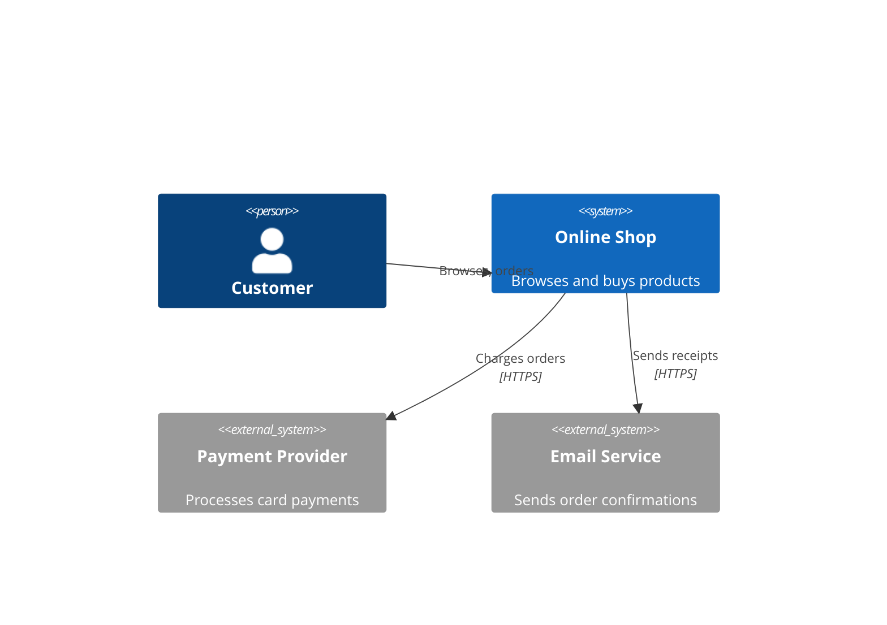

# Software Architecture

## Purpose

This skill guides the design and evaluation of software architecture so a
system is understandable, changeable, and resilient before code is written.
It produces a documented structure — components, boundaries, data flow, and
the reasoning behind each choice — that the rest of the team can build
against and review.

## When to Use

- Starting a new application, service, or major subsystem.
- Restructuring a codebase that has grown hard to change.
- Choosing between a monolith, modular monolith, or distributed services.
- Reviewing an existing architecture for scalability, coupling, or failure modes.
- Deciding where a new feature belongs in an existing system.
- Evaluating a technology choice that will be hard to reverse.

## When Not to Use

- For a small, well-understood change inside one module — follow the
  existing structure instead of redesigning it.
- For code-level quality concerns — use `clean-code` or `code-review`.
- For recording a single decision — use `technical-decision-records`.
- For pure performance tuning of an existing system — use `performance`.

## Prerequisites

- A written statement of the problem, the users, and the success criteria.
- Knowledge of the non-functional requirements: expected load, latency
  budget, availability target, data sensitivity, and team size.
- Access to the existing codebase and deployment setup when changing an
  existing system.
- Conceptual skill; version range: none — applies to any stack; the C4
  model and Twelve-Factor principles linked in Official Documentation
  are versionless.

## Official Documentation

- [C4 model](https://c4model.com/) — the diagram notation this skill uses.
- [The Twelve-Factor App](https://12factor.net/) — principles for
  building portable, deployable services.
- [Martin Fowler on architecture](https://martinfowler.com/architecture/) —
  essays on patterns, trade-offs, and evolutionary architecture.

## Required Workflow

1. State the problem and constraints in writing: users, scale, latency,
   availability, compliance, team size, and timeline.
2. List the quality attributes that matter most and rank them; no system
   can maximise all of them at once.
3. Draw the system context (C4 level 1): the system, its users, and the
   external systems it depends on.
4. Draw containers (C4 level 2): the deployable units and how they
   communicate, including the protocol and direction of each link.
5. Draw components (C4 level 3) for the parts that carry the most risk
   or complexity.
6. Define module boundaries and dependency direction: dependencies point
   inward toward the domain, never outward toward infrastructure.
7. Decide data ownership: every piece of data has exactly one owning
   service or module; others read it through an explicit interface.
8. Identify failure modes: what happens when each dependency is slow,
   unavailable, or returns bad data; add timeouts, retries with backoff,
   and fallbacks where the cost is justified.
9. Record each significant decision as an ADR (see
   `technical-decision-records`) with the alternatives considered.
10. Review the design with the Validation Checklist before building.

## Implementation Standards

- Start with a modular monolith unless a concrete requirement forces
  distribution; splitting services is easy later, merging them is hard.
- Every module exposes an explicit public interface; internal details
  stay private to the module.
- Dependencies flow one way. A dependency cycle between modules is a
  defect, not a style choice.
- Communication between deployable units goes through versioned,
  documented contracts (API schemas, events, or messages).
- Configuration lives outside code, in environment variables or a
  configuration store, never hard-coded.
- State is explicit: know which components are stateless, which hold
  state, and where state is persisted and backed up.
- Diagrams are kept in the repository as text (Mermaid or PlantUML) so
  they stay versioned and reviewable with the code.

## Best Practices

- Design for change at the boundaries that actually change: the parts
  with the most churn deserve the cleanest interfaces.
- Prefer boring, well-understood technology for the core; reserve novel
  tools for the places where they earn their cost.
- Make the happy path obvious and the failure path explicit in every diagram.
- Keep the number of deployable units as small as the requirements allow.
- Revisit the architecture after the first real usage data arrives;
  early designs are hypotheses, not contracts.
- Name components after the domain they serve, not the technology they
  use, so renames do not follow every framework change.

## Security Considerations

- Identify the trust boundaries on the context diagram: every crossing
  needs authentication, authorisation, and input validation.
- Secrets never appear in diagrams, code, or configuration files; use a
  secret manager and reference secrets by name.
- Default to least privilege between services: a service can only call
  the endpoints it needs.
- Log security-relevant events (authentication failures, authorisation
  denials) at every trust boundary.
- See `security` for the full threat-model and hardening checklist.

## Performance Considerations

- Set a latency and throughput budget before designing, and assign a
  share of it to each hop in the request path.
- Prefer fewer network hops on the hot path; each hop adds latency and a
  failure mode.
- Design data access around the queries the system actually runs, not
  around an idealised schema.
- Plan caching deliberately: what is cached, where, for how long, and
  how it is invalidated. Accidental caching is a bug source.
- See `performance` for measurement and profiling guidance.

## Common Mistakes

- Microservices by default — distributed systems add operational cost,
  latency, and failure modes that a small team may not need.
- Drawing diagrams that do not match the code — diagrams drift unless
  they live in the repo and are reviewed with changes.
- Designing for hypothetical scale — build for the load you can
  forecast, with a clear path to scale when the data demands it.
- Shared databases between services — this couples services at the
  schema level and defeats the purpose of the split.
- Ignoring the operational view — a design is incomplete without
  deployment, monitoring, logging, and rollback.
- Letting every module depend on every other module — enforce the
  dependency direction with tooling or code review, not good intentions.

## Examples

Context diagram in Mermaid (C4 level 1), kept in the repository:



Module boundary rule, stated as a checkable convention:

```text
domain/        -> no imports from infrastructure/ or web/
application/   -> imports domain/ only
infrastructure/-> imports domain/ and application/
web/           -> imports application/ and infrastructure/
```

## Validation Checklist

- [ ] The context and container diagrams exist in the repository and
      match the code being built.
- [ ] Every component has one clear owner and one clear responsibility.
- [ ] No dependency cycles exist between modules.
- [ ] Every external dependency has a documented failure behaviour.
- [ ] Data ownership is unambiguous: one owner per data set.
- [ ] Significant decisions are recorded as ADRs with alternatives.
- [ ] Security trust boundaries are marked and protected.
- [ ] The design can be explained to a new team member in under ten minutes.

## Expected Deliverables

- C4 diagrams (context, containers, and components for risky areas) in
  the repository as text-based diagrams.
- A written architecture overview: components, boundaries, data flow,
  and the ranked quality attributes.
- ADRs for each significant decision, including rejected alternatives.
- A list of open risks with the plan to resolve each one.

## References

- [C4 model](https://c4model.com/) — diagram notation and levels.
- [The Twelve-Factor App](https://12factor.net/) — service design
  principles.
- [Martin Fowler on architecture](https://martinfowler.com/architecture/) —
  essays on architectural patterns and trade-offs.
- Related skills in this repository: `technical-decision-records`,
  `clean-code`, `security`, `performance`, `design-patterns`.
